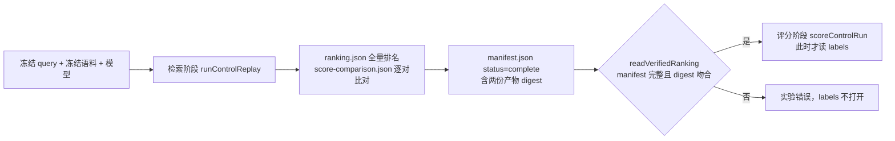

# 方案 C G0：实验协议、角色样本格式与成本预算

> 日期：2026-10-08。读者：Lorelum 维护者与检索实验实现者。状态：G0 产物登记，不是产品合同。本文只回答“后续实验是否可重放、无标签泄漏、可正确归因，并且比较规则已预先固定”，**不回答方案 C 是否有效**，也不授权进入 G1。路线与门槛见 [角色对齐检索与受控学习验证路线](./role-aligned-retrieval-plan.md)；control 的实测证据见 change 的 [verification §25](../../openspec/changes/advance-task-aware-semantic-retrieval/verification.md)。

实现位于 `packages/backend/src/benchmark/role-aligned/`。它是 benchmark 内部工具，不在包 `exports`、CLI 或 Backend API 中；生产 `scoreSemanticPractice`、golden pin、Profile、持久化 schema、迁移与公共 Practice/Pack schema 均未改动。

## 1. 阶段隔离

- 检索阶段的配置与依赖里没有 labels 路径；评分阶段在 `readVerifiedRanking` 通过前不调用 `readLabels`（测试用读取计数证明）。
- 每个条件对全部 eligible Practice 评分并排序一次，**排名产物保存完整排序**；K（结果数 5、候选宽度 20、报告名次 1/3/5/20）只在读取排名时应用。
- 实验错误与检索失败分开：输入缺失/不一致/损坏、编码失败、协议违规、评分不一致分别以 `ExperimentError` 代码（`input_missing`、`input_mismatch`、`input_corrupt`、`protocol_invalid`、`run_failed`、`stage_violation`、`score_mismatch`）终止，并写入 `status: "failed"` 的 manifest。失败的运行不会被评分，标签文件错配（缺 query、多 query、未知 Practice、修订不符）同样是协议错误，而不是 miss。
- 运行目录保存 query 文本、向量与排名，必须位于仓库之外（工具拒绝仓库内目录）；本机路径只写入运行目录的 `local-environment.json`，不进入 manifest。

## 2. Manifest

`manifest.json`（`manifest.ts` 的 zod 定义为准）至少记录：

| 类别 | 内容 |
| --- | --- |
| 代码身份 | commit；被测源码与工具源码（21 个文件）的逐文件 SHA-256 及其合并 digest；`listedFilesDirty`。HEAD 不能代表未提交工作区，所以逐文件 digest 才是身份 |
| 输入身份 | query 文件 SHA-256、修订与条数；语料 digest（engine `indexCorpusDigest`）、Store snapshot identity、Practice/view 数；模型 SHA-256 与字节数；native runtime manifest SHA-256 |
| 编码合同 | encodingId、Profile ID、pooling（取自生产 `llamaArguments`）、l2 归一化、threads、向量维度 |
| 投影与策略 | document projection v4、query projection v2、向量缓存身份、候选策略 `role-aligned-policy/1` 的 digest、成本预算 `role-aligned-cost-budget/1` 的 digest |
| 评分 | 生产公式标识、resultLimit、candidateWidth、报告名次、排名深度（=全部 eligible Practice 数） |
| 比对 | 逐对数量、最大绝对误差、容差 `1e-6`、不一致数、生产/独立复算的排序是否逐 query 相同 |
| 产物 | `ranking.json`、`score-comparison.json` 的文件名、SHA-256、字节数 |
| 成本 | 各阶段毫秒、编码调用数与预先固定的调用预算、缓存状态、IO 字节、本进程峰值 RSS、冷/部分/热缓存条件 |
| 环境 | 平台、架构、Bun 版本、CPU 型号与核数、内存总量 |

冻结输入由 `frozen-inputs.ts` 固定：query、模型、native manifest 的摘要与 2026-10-01 表示审计的 `protocol.json` 逐一相同；语料 digest 在 2026-10-08 首次观测后固定。向量缓存只在“模型、编码合同、threads、native manifest 与全部被测代码 digest 完全相同”时复用；身份不符或缓存损坏时丢弃并重新编码，不报错也不信任旧缓存。

## 3. 角色样本格式

一个文件描述一个 query（`role-sample.ts`，`formatVersion: 1`）：

| 字段 | 含义 |
| --- | --- |
| `queryId`、`queryDigest` | 必须匹配 query 身份与 UTF-8 原文的 SHA-256 |
| `spanUnit` | 固定为 `utf16-code-unit`：偏移是 JavaScript 字符串下标，半开区间 `[start, end)`；不允许切开代理对 |
| `analysisKind`、`analysisVersion` | `manual`/`automatic` 与具体版本，例如 `manual/1`；不记录伪造的数值置信度 |
| `roles[].role` | `intent`/`moment`/`artifact`/`constraints`/`domain`/`unknown` |
| `roles[].actionGroup` | 可选；同一 query 含多个动作时，把 moment/artifact/constraints/domain 关联到开启该组的 intent |
| `roles[].spans` | 一个或多个原文片段，升序且不重叠 |
| `roles[].text` | 将被编码的角色文本 |
| `roles[].restated` | 文本是否与片段不同；`false` 时必须逐字等于片段以单个空格连接 |
| `roles[].inference` | 角色归属理由；重述时说明使用了哪些原文事实 |

允许角色缺失、一个片段同时承担多个角色、多个动作；`unknown` 只记录无法归类的片段，永不编码、永不计分，也不得重述或归入动作组。校验器拒绝：片段越界/空/乱序/重叠/切开代理对、文本与片段不符、`restated` 与文本一致性相反、同一 `(角色, 动作组, 文本)` 重复、指向不存在 intent 的动作组、未知字段、其它版本。样本的角色按规范顺序排序后计算 digest，输入顺序不影响结果。

限制：校验证明结构与来源锚定，**不能证明重述没有补造事实**，也不能判断必要条件是否被当成背景；这两点依赖标注者的 `inference` 与独立复核。标注者看不到目标 ID、排名与 labels。

## 4. 单一候选策略 `role-aligned-policy/1`

读取任何新测试结果之前固定。权重来自研究计划 §4.1 的先验判断，不经搜索，也不使用 Pack/Practice ID。

| 项目 | 规则 |
| --- | --- |
| 角色权重 | intent 3，constraints 2，artifact 2，moment 1，domain 1；对实际出现的角色归一化。当前动作决定适用性；约束改变适用性，因此不低于被约束的 artifact；domain 不独自决定任务 |
| 组内证据归约 | 同一角色的多个文本取等权均值（跨动作组），文本按 UTF-16 码元排序；文档侧沿用生产 task-card 最佳 + body（最佳与均值各半）归约 |
| 缺失角色 | 省略并重新归一化其余权重；不补默认分数 |
| 空通道 | 无 task-card 或无 body 的 Practice 只用其拥有的分量，与生产 clause 分数一致 |
| 负余弦 | 保持有符号：不截断、不设地板、不加扣分项；全部权重非负 |
| 重复证据 | 同一角色内相同文本只编码并计一次；同一文本出现在两个角色时每个角色各计一次；文档 view 不去重 |
| unknown | 不编码不计分 |
| tie-break | 分数降序，然后 Practice ID 按 UTF-16 码元升序（与生产 reader 相同） |
| 回退 | 没有可计分角色的 query 用生产 clause 路径评分并计入回退次数；不确定性不会把 Practice 排除 |
| 禁止 | 词面通道、名次融合、候选截断、多轮、Pack/Practice ID 特征、权重搜索 |

`candidate-policy.ts` 中的 `planRoleQuery` 与 `fuseRoleEvidence` 把这些规则写成可测的确定性函数；余弦本身由 G1 的条件实现计算。

### 4.1 归因条件与负对照

| 条件 | 相对前一条件的唯一改变 | 保持不变 | 门槛 |
| --- | --- | --- | --- |
| control | 无 | 生产公式、query clause 拆分、文档 views、模型 | G0：全部 query × Practice 复算 ≤ 1e-6 且冻结指标复现 |
| Q | 人工来源角色文本及上表的跨文本权重 | 文档 views、生产组内归约、模型 | G1 |
| Q+I | 取最大值的位置：每个 task-card/body view 先按角色权重汇总各角色余弦，再按生产 max/mean 归约，因此同一证据单元须同时支持多个角色 | Q 文本、文档向量、模型 | G1 |
| Q+I+D | 增加有来源的文档角色视图，作为单独编码干预 | query 与融合策略 | G2，仅当 Q+I 通过 |

负对照：追加不改变任务含义的背景文本；用等义措辞重述各角色且不增加事实；同样处理预算下的非角色文本。随机化须固定 seed。Q 不是完整 C，Q+I 也不能凭空获得不存在的文档角色；换模型不属于任何条件，需另立提案。

## 5. 新增 pilot 标注协议（版本 1）

旧 v2 的 50 例只承担开发与回归，其标签与 `coreIds` 不变。pilot 建议先采集 24–40 条真实、边界明确的任务，覆盖当前缺口、条件近邻和无相关目标；这是工作量建议，不是统计功效保证。query 不得照着目标 Practice 反向编写，须在策略冻结前采集、标注并分配用途。

`pilot-labels.ts` 校验每个 query 一个标注文件：

| 类别 | 含义 |
| --- | --- |
| `required-core` | 缺它任务得不到服务 |
| `sufficient-alternative` | 单独即可服务任务；与 required-core 并列 |
| `prerequisite-or-supplement` | 有帮助，但不能单独服务任务 |
| `irrelevant` | 无关 |
| `forbidden` | 应用于该任务会误导 |
| `undetermined` | 无人能可靠判断；评审分歧只能落在此类并记录竞争类别与说明 |

规则：一个 Practice 只有一个类别且 `contentDigest` 必须匹配冻结语料；未列出的 Practice 是**未标注**，既不算无关也不算负例；没有可接受项时必须显式 `noRelevantTarget: true`，不能由空列表推出；单评审者或非盲评审必须在 `disclosure` 中写明依赖风险，不能宣称独立验收。替代项**不得**追加进 v2 `coreIds`（现有 scorer 要求全部 core 命中，追加会反而加严）。

成功判定（版本 1，**已被 [G1 协议 §1](./role-aligned-g1-protocol.md) 的版本 2 取代**）：前 K（默认 5）包含至少一个 `required-core` 或 `sufficient-alternative` 且无 `forbidden`。该口径与 `required-core`“缺它任务得不到服务”不一致——多个必需核心时命中其一不应算成功——所以版本 2 拆为 `fullyServed`、`anyHelp` 并以 `success = fullyServed ∧ 无禁项` 为主指标；版本 1 标签文件不再被接受。`summarizeTopK` 同时给出每类计数与未标注数，用于比较各条件的标注覆盖是否可比；覆盖不可比时结论为“不确定”。需要补判时，匿名合并各条件输出、打乱顺序独立评审，其结果只产生新的补充审计，不回写原标签。

## 6. 成本预算 `role-aligned-cost-budget/1`

实测基线与推导见 verification §25；预算在任何角色条件结果出现前冻结，代码登记在 `cost-budget.ts`。预算约束成本，不与质量互相折算；违反预算阻止产品接入，但不改变质量结论。

| 项目 | 上限 | 依据 |
| --- | --- | --- |
| 每 query 编码文本数 | ≤ 8 | control 最多 4 个 clause |
| 每 query 编码延迟 p95 | ≤ 165 ms | control 41.3 ms × 4 |
| 每 query 评分均值（97 Practice / 1232 views） | ≤ 8 ms | control 0.8 ms（热）至 2.1 ms（冷，四次运行最差），约为最差冷值的 3.8 倍 |
| analyzer 新增延迟 p95 | ≤ 200 ms，每 query 仅 1 次调用，禁止逐 Practice 调用 | 约 control p95 的 4.8 倍 |
| analyzer 新增常驻内存 | ≤ 450 MB | 约 1 倍 embedding runtime 实测峰值 |
| 端到端 query p95（analyzer + 编码 + 评分） | ≤ 400 ms | 三项上限之和 373 ms 加余量 |
| 评估进程峰值 RSS | ≤ 190 MB | control 120.8–128.6 MB（多次运行），约为最差值的 1.5 倍 |
| native runtime 峰值工作集 | ≤ 500 MB | control 449 MB（250 ms 采样，是下界）加余量 |
| runtime 启动 | ≤ 8.1 s | control 1.0 s（模型文件已在系统缓存）至 6.5 s（最差），× 1.25 |
| 新增文档编码 | Q、Q+I 为 0；Q+I+D ≤ 1232 views 的 25% | 复用现有文档向量 |

测量规则：单个顺序请求，预热 runtime（丢弃一次编码）后，对评估集每个 query 取 p95；冷启动与冷缓存单独报告，不并入均值。预算只适用于已测设备类别与当前 97 Practice / 1232 views，不构成大规模容量结论：评分计算量随“文本数 × view 数 × 维度”线性增长，这里的数据不能外推。analyzer 本身尚未实现，上表对它的限制是预先固定的门槛，不是实测。

## 7. 进入 G1 之前仍然成立的约束

- control 复现成立只说明实验基础可用；G1 的 Q 与 Q+I 必须在独立来源角色标注下运行，并在保存完整排名后才读标签。
- 开发集已被反复使用，不是独立验收集；不能通过重新切分把旧样本变成未见测试集。
- 通过研究计划 §6.3 的全部门槛前，不进入产品接入；若调整门槛，须在看到新测试结果之前完成并说明原因。
- 私有 labels、原始 query 日志、向量缓存与机器特定产物不提交。
